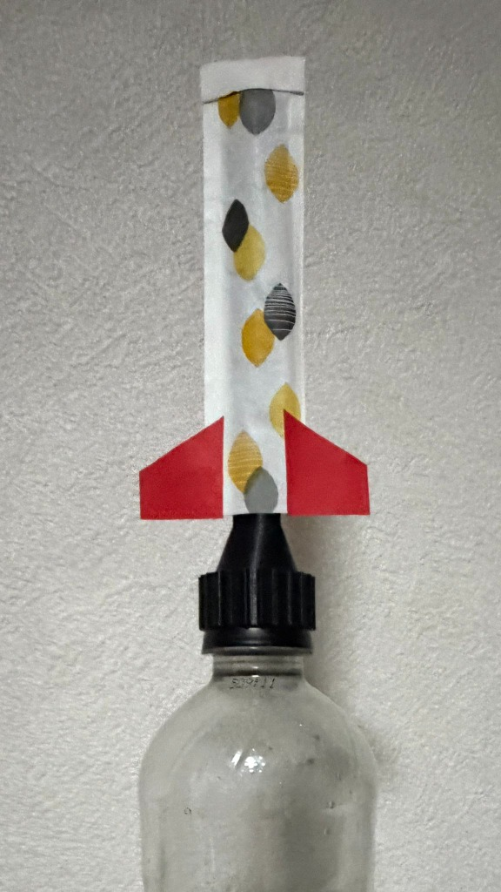
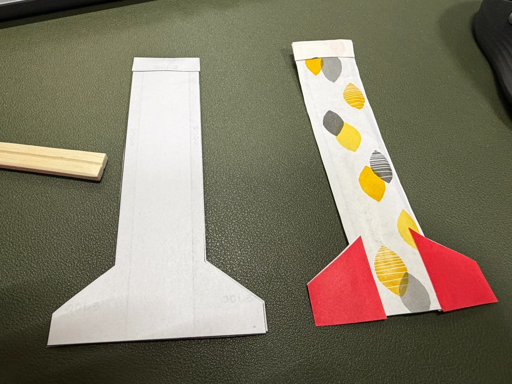
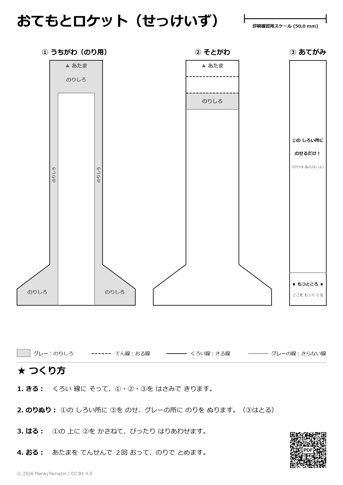
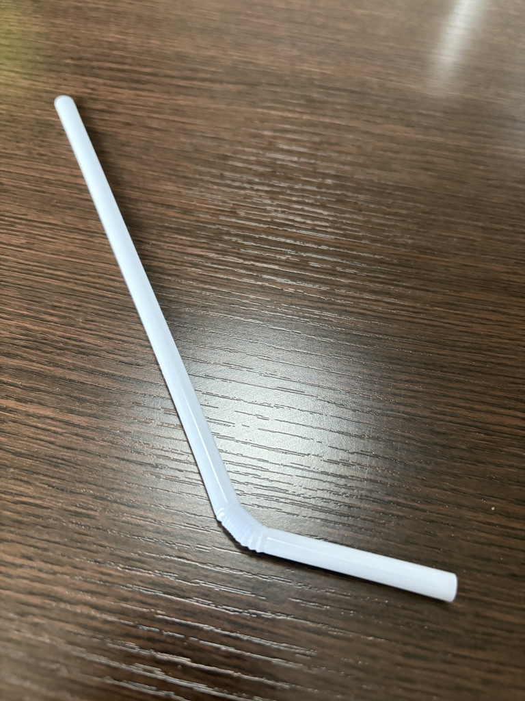

# OtemotoRocket（おてもとロケット） 🚀🥢

**「500mlペットボトル直接圧縮」×「割り箸袋（おてもと）規格 超軽量紙ロケット」×「3Dプリント製レンズ型直結ノズル」** による、安全で力強く飛翔する空気圧打ち上げロケットシステムです。

市販の500ml炭酸飲料ペットボトルに3Dプリント製ノズルキャップを装着し、手でボトルを叩く（潰す）だけで、瞬間的な高圧エアパルスによって軽量紙ロケットがスポーンと気持ちよく垂直に打ち上がります。

<p align="center">
  
  
  <br>
  <em>（写真左: 500mlペットボトル発射台への装填状態 ／ 写真右: 左が型紙せっけいずから製作、右が実際の割り箸袋＋折り紙尾翼で製作したロケット）</em>
</p>

---

## 特徴（Key Features）

1. **道具不要・ホース不要の超シンプル直結方式（ストローでも発射可能！）**
   - ペットボトルキャップ（PCO-1881規格）と発射ノズルが一体成型された3Dプリントパーツ1個のみ。
   - ホースや継手を一切排除した直結構造のため、圧損ゼロ・エア漏れゼロで瞬間パルスをダイレクトにロケットへ伝達。
   - **3Dプリンターがない場合でも、市販の曲がるストローを使って息の力で手軽に飛ばせます！**
2. **失敗しない「当て紙」マスキング工作システム**
   - 自宅のプリンター（A4普通紙）で等倍（1:1）印刷できる型紙データ（PDF / SVG）を同梱。
   - ③「あてがみ」を中央に置くだけで空気管エリアが100%保護され、大雑把に糊を塗っても筒が塞がらない**ポカヨケ設計**。小学2年生でも一人で組み立て可能。
3. **本物の割り箸袋（4型規格）でもそのまま作れる**
   - コンビニやお弁当についてくる実際の割り箸袋（4型がおすすめ）をハサミで切って折り紙の尾翼をつけるだけでもバッチリ飛びます。
4. **低摩擦射出を実現するヒラメ型（レンズ型）ノズル**
   - 割り箸袋の扁平形状に合わせ、外寸15.0mm×4.5mmのレンズ断面を採用。
   - 130mmの均一ストレートガイドにより、発射時のぐらつきを防ぎ、軽い力でもスムーズにスポーンと抜ける低摩擦射出を実現。

---

## 🚀 ロケットの作り方

おてもとロケットは、**「① A4型紙（せっけいず）から印刷して作る」**方法と、**「② 実際の割り箸の袋から作る」**方法のどちらでも手軽に作れます！

### 作り方A: A4型紙（せっけいず）から作る
型紙データ（[docs/otemoto_rocket_blueprint_a4.pdf](docs/otemoto_rocket_blueprint_a4.pdf)）をA4普通紙に**等倍（100%スケール）**で印刷します。尾翼が一体成型されているため、歪みなく高精度なロケットがハサミと糊だけで作れます。

<p align="center">
  
</p>

1. **きる**: 黒い線に沿って、①・②・③をハサミで切り抜きます。
2. **のりぬり**: ①の白い所に③あてがみを乗せ、グレーののりしろ全面に糊を塗って③を外します。
3. **はる**: ①の上に②をぴったり重ねてフチまで密着・接着します。
4. **おる**: 先端（あたま）を点線に沿って手前に2回折り、糊で固定します。

### 作り方B: 実際の割り箸の袋から作る（より手軽！）
身近にある**本物の割り箸の袋（一般的な「4型」規格がおすすめ）**を使えば、型紙の印刷すら不要で今すぐロケットが完成します！
※冒頭の写真右側に写っている赤い尾翼のロケットは、実際の割り箸袋＋折り紙で製作したプロトタイプです。

1. **長さをカット**: 箸袋の開口部にあるU字の切り込みをハサミで直線に切り落とし、全長を約130mmに揃えます（切り口を均一にすることで空気漏れを防ぎます）。
2. **尾翼をつける**: 折り紙や画用紙を台形や三角形（張り出し20mm程度）に切り、セロハンテープや糊でロケット下部の左右に貼り付けます。
3. **先端を補強**: 先端（袋の底部分）を手前に1〜2回小さく折り返し、セロハンテープで留めると気密性と強度がアップします。

---

## 🖨️ 発射ノズルの3Dプリント（3D Print Launcher）

- **CADファイル**: [`cad/launcher.scad`](cad/launcher.scad)（OpenSCAD 単一ファイル自己完結・外部依存なし）
- **STLファイル**: [`stl/launcher_cap_nozzle.stl`](stl/launcher_cap_nozzle.stl)（全高 160.05 mm）
- **3MFファイル**: [`stl/launcher_cap_nozzle.3mf`](stl/launcher_cap_nozzle.3mf)（Bambu Lab向け設定済み）

### 推奨プリント設定
- **造形方式**: FDM / FFF
- **使用プリンター例**: Bambu Lab A1 mini / A1 / P1S / X1C（ビルド高 180mm 以上）
- **サポート**: **不要（Support-free）**
- **レイヤー高さ**: 0.20 mm
- **周長壁（Wall loops）**: 3周（肉厚 1.2 mm 中実化で気密・高剛性を確保）
- **材質**: PETG または PLA（靭性・気密性からPETG推奨）

---

## 🎯 発射・遊び方

### 方式A: ペットボトル発射（3Dプリントノズル）
1. よく洗って乾かした **500mlペットボトル**（炭酸飲料等のPCO-1881規格ボトル）を用意します。
2. 3Dプリントしたノズルキャップをペットボトルの口にしっかりねじ込みます。
3. 完成したロケットを発射管の根元までスッと差し込みます。
4. 周囲の安全を確認し、ペットボトルの側面を手で勢いよく叩くか、両手で瞬時に押し潰します。
5. **「スポーン！」** と勢いよくロケットが打ち上がります！

### 方式B: ストロー発射（3Dプリンター不要！息でシュッと発射）
3Dプリンターをお持ちでない場合でも、市販の**ストロー（曲がるストローがおすすめ）**を使って息の力で簡単に発射できます！

<p align="center">
  
</p>

- **遊び方**:
  1. 曲がるストローの長い方をロケットの筒の中に差し込みます。
  2. 蛇腹部分を少し曲げると、狙った方向（斜め上）にロケットを向けやすくなります。
  3. 周囲の安全を確認し、短い方の端から**「フッ！」**と一気に息を強く吹き込みます。
  4. 軽い力でも勢いよくスポーンと飛び出します！

---

## 📁 ディレクトリ構成

```text
OtemotoRocket/
├── cad/
│   ├── launcher.scad                # 発射台 OpenSCADソースコード
│   └── otemoto_rocket_blueprint_a4.svg # A4型紙ベクターデータ
├── docs/
│   ├── launcher_and_rocket_assembled.jpg # 発射台・ロケット実機写真
│   ├── launcher_straw.jpg           # ストロー発射器写真
│   ├── rocket_prototype_vs_printed.jpg   # プロトタイプ対比写真
│   ├── otemoto_rocket_blueprint_a4.pdf   # 印刷用型紙PDF（1:1等倍）
│   └── otemoto_rocket_blueprint_a4.png   # 型紙プレビュー画像
├── stl/
│   ├── launcher_cap_nozzle.stl      # 発射台 3Dプリント用STL
│   └── launcher_cap_nozzle.3mf      # 発射台 Bambu 3MF設定ファイル
├── .gitignore
├── LICENSE                          # CC BY 4.0 ライセンス規約
└── README.md
```

---

## 📜 ライセンス

本プロジェクトの設計図（型紙PDF/SVG）、3Dモデル（SCAD/STL/3MF）、ソースコードおよびドキュメントは、**[クリエイティブ・コモンズ 表示 4.0 国際 ライセンス (CC BY 4.0)](https://creativecommons.org/licenses/by/4.0/deed.ja)** の下で公開されています。

[](https://creativecommons.org/licenses/by/4.0/deed.ja)

- **クレジット表示（原作者名やリポジトリへのリンク）** を行っていただければ、個人利用、学校・ワークショップでの教育利用、改変、さらには商用利用を含め、どなたでも自由にご活用・再配布いただけます。
- 詳細は [LICENSE](LICENSE) をご確認ください。

---

## 👤 著者・クレジット (Author & Attribution)

- **作者 / Project Creator**: [ManeyYamazin](https://github.com/ManeyYamazin)
- **リポジトリ**: [https://github.com/ManeyYamazin/OtemotoRocket](https://github.com/ManeyYamazin/OtemotoRocket)

### クレジット表記例 (Attribution Example)
本プロジェクトのデータや型紙を利用・改変・再配布、またはワークショップやSNS・動画等で紹介される際は、以下のようにクレジットを記載してください：

> **おてもとロケット by ManeyYamazin (CC BY 4.0)**  
> または  
> `OtemotoRocket by ManeyYamazin (https://github.com/ManeyYamazin/OtemotoRocket) - Licensed under CC BY 4.0`
